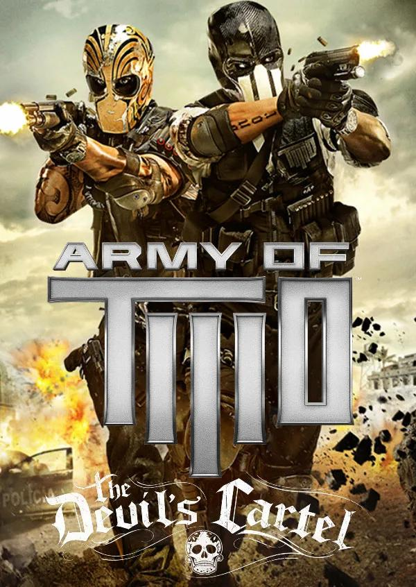

# Army of Two: The Devil's Cartel - PC recompilation

<p align="center">
  
</p>

> **Image notice:** I do not own this image. The *Army of Two: The Devil's Cartel* cover art is
> the property of its respective owners (Electronic Arts Inc.) and is included here for
> identification purposes only.

A static recompilation of the Xbox 360 version of *Army of Two: The Devil's Cartel* to a native
Windows executable, built on the [ReXGlue SDK](https://github.com/rexglue/rexglue-sdk). The
game's PowerPC code is translated to C++ at build time from **your own** disc dump; the SDK
provides the Xbox 360 kernel, GPU (Direct3D 12), audio and input.

This repository contains **no game code or data**. You need a legally owned copy of the game.

## Project-side additions

On top of the plain recompilation:

- **Player settings window** (`F4`) - a themed settings page with only what players need:
  key bindings (with the game's action names), mouse sensitivity and invert Y, fullscreen,
  V-Sync, aspect ratio, image filter, texture filtering, mute. "Advanced settings" shows every
  SDK option.
- **Keyboard and mouse** - WASD movement, mouse look, LMB fire, RMB aim, Shift dash; all
  rebindable in the settings window or `settings/hardware.toml`.
- **Rendering fixes for this game** (see `thirdparty/patches/`):
  - HDR scene resolved and sampled as integers (the integer number format of 16-bit fixed
    textures, unsupported upstream) - without it the game renders almost black.
  - Memexport (GPU-written data) is copied back to game memory per changed value, queued
    instead of stalling - the game's GPU particles otherwise corrupt the job system or stutter.
  - Only the render results the CPU actually reads are copied back (the lighting input and the
    small exposure buffers), instead of every resolve.
  - The screen-space ambient occlusion pass renders as horizontal stripes under emulation and
    is replaced with "no occlusion" (`ao2dc_disable_ssao`).
  - Delayed render readbacks no longer overwrite the GPU's newer copy (smoke and other
    half-resolution effects were cut into 32-pixel blocks).
- **Recompiler fixes** - PowerPC memory barriers (`sync`, `lwsync`, `eieio`) are emitted as fences
  instead of nothing, so the compiler cannot reorder the game's lock-free thread handoffs; the
  vector 2^x estimate (`vexptefp`) no longer wraps to huge values for very negative inputs (the
  audio mixer's decibel-to-gain conversions use it).
- **Audio** - a look-ahead limiter (`audio_limiter`, on by default) keeps the game's mix from
  hard-clipping when gunfire stacks several copies of a sound, and underruns fade instead of
  clicking. `ao2dc_audio_record` saves the last 90 s of the game's mix and of the device signal
  to `logs/` and enables the XMA diagnostics in the log.
- **60 FPS (experimental)** - `ao2dc_frame_rate = 60` in `settings/hardware.toml` (restart
  needed) makes the game's own frame pacer and its tick-based systems run at 60 at normal game
  speed (`src/main_hooks/frame_rate_hook.cpp`). Tested at 60 from the start of the game through
  the Cause and Effect mission; the default `0` keeps the original 30 FPS. Keep
  `readback_resolve = "fast"` (the default) - `"full"` costs too much at 60 FPS.
- **FPS counter** - "Show FPS counter" in the `F4` window (Display tab).
- **Kernel fixes** - stale dispatch objects in reused memory (crash on `KeSetEvent`), instant
  storage-device selection.
- **Crash report** - a crash writes the faulting call stack, with recompiled function names, to
  `logs/crash.txt` next to the executable.

## Requirements

- Windows 10/11, a Direct3D 12 GPU with rasterizer-ordered views (any recent AMD/NVIDIA/Intel)
- CMake 3.25+
- Git (SDK submodule + patches)
- Ninja
- Clang / LLVM (`winget install LLVM.LLVM`), plus the Visual Studio 2022 Build Tools (C++
  workload) for the Windows SDK and linker environment
- About 16 GB of free RAM for the code generation step
- ABGX360 to dump the Xbox 360 disc, or
  [extract-xiso](https://github.com/XboxDev/extract-xiso) to unpack an existing ISO
- Your own legally owned copy of *Army of Two: The Devil's Cartel* (Xbox 360)

## Getting the SDK

The ReXGlue SDK is pinned as a git submodule in `thirdparty/rexglue-sdk` and built together with
the game:

```
git clone --recursive <this repo>
# or, in an existing clone:
git submodule update --init --recursive
```

Local SDK fixes live in `thirdparty/patches/` and are applied to the submodule at configure time
by `cmake/apply_sdk_patches.cmake` (idempotent; the submodule's commit is never changed).

## Getting the game data

1. Dump the Xbox 360 disc with ABGX360 (verify it against the values below) or extract an
   existing ISO with extract-xiso, which unpacks the disc's file tree.
2. Copy the extracted contents directly into `assets/`, so `default.xex` sits at
   `assets/default.xex` alongside the rest of the disc's files (`$SystemUpdate/`, `Content/`,
   `Data/`, `Movies/`, `AO4.Main.xex`, `AO4.Splash.xex`, `Engine.BuildInfo.xex`, `NxeArt`).
   Some tools extract it as `Default.xex`; either spelling works on Windows.
3. `assets/` is gitignored (`assets/*` in `.gitignore`, with `assets/README.md` as the only
   tracked file) - nothing from the disc is, or should be, committed to this repo.

The game files are never copied into the build output either: the recompiler reads the three
XEX files from `assets/` at build time, and the game reads its data from `assets/` at run time.

Target retail release (verify your dump matches):

| Field     | Value       |
|-----------|-------------|
| Title ID  | `454109AB`  |
| Media ID  | `60F8EF51`  |
| Version   | `0.0.0.11` (disc 1/1, no title update) |

| File                   | SHA-1                                      |
|------------------------|--------------------------------------------|
| `default.xex`          | `b7f987b19a6f392d6c74b65444bd4b3e4eb8d924` |
| `AO4.Main.xex`         | `64da993ea47798252dd580c8625afac45b64df27` |
| `Engine.BuildInfo.xex` | `3ad0e5f5913d68c927a67439e833538e613b0558` |

`default.xex`, `AO4.Main.xex` and `Engine.BuildInfo.xex` all carry the Title ID, Media ID and
version above. The build also prints them for every XEX it recompiles. Check the hashes with
`certutil -hashfile assets\AO4.Main.xex SHA1` (Windows) or `sha1sum assets/*.xex`.

## Building

Put your dump in `assets/` (above) and run **`build_from_dump.bat`**. It checks the files and
their SHA-256 hashes, finds the toolchain, recompiles the game and compiles the project. Your dump
is never modified. **[BUILDING.md](BUILDING.md)** has the prerequisites, exact Windows 11 steps,
the equivalent manual commands and troubleshooting.

## Running

Run `out/build/win-amd64-release/ArmyOfTwoTDC X360 Recomp.exe`. Saves, the shader cache and logs stay inside the
project (`user/`, `cache/`, `out/build/.../logs/`).

Default controls: WASD move, mouse look, LMB fire, RMB aim, Shift dash, Space/Enter A, Backspace/F
B, R/E X, Q Y, G LB, V RB, Esc Start, Tab Back, 1-4 or arrows D-pad. Press `F4` for settings;
Alt+Tab releases the mouse.

## Settings

`settings/hardware.toml` holds the runtime settings (graphics, input, the game-specific fixes).
The `F4` window edits and saves the same file.

## Legal

This project does not include any part of the game. Army of Two is a trademark of Electronic
Arts Inc. This project is not affiliated with or endorsed by Electronic Arts.
