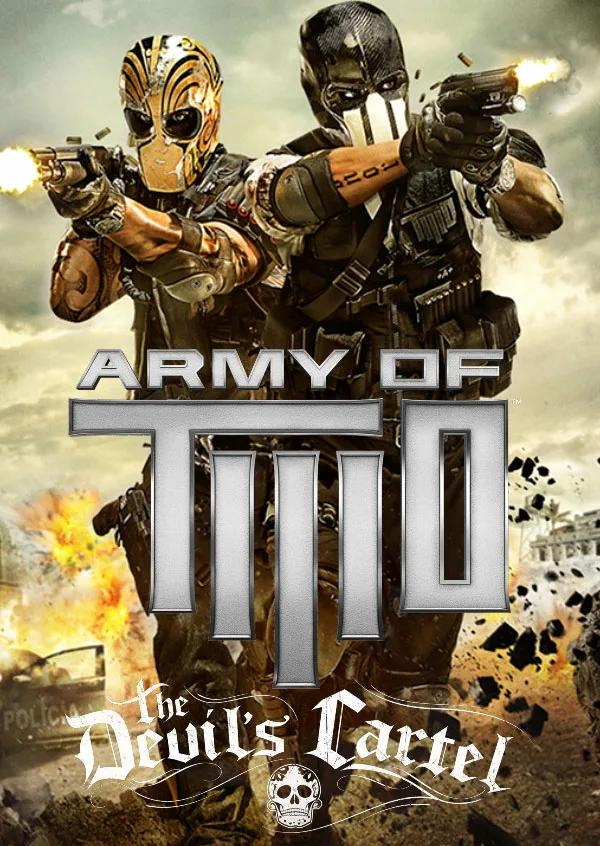

# Army of Two: The Devil's Cartel - PC Recompilation

[](https://recompstore.com/dev/brewsparrow)

<p align="center">
  
</p>

> **Image notice:** I do not own this image. The *Army of Two: The Devil's Cartel* cover art is
> the property of its respective owners (Electronic Arts Inc.) and is included here for
> identification purposes only.

A static recompilation of the Xbox 360 version of *Army of Two: The Devil's Cartel* to a native
Windows executable, built on the [ReXGlue SDK](https://github.com/rexglue/rexglue-sdk). The
game's PowerPC code is translated to C++ at build time from **your own** disc dump; the SDK
provides the Xbox 360 kernel, GPU (Direct3D 12), audio and input.

This repository contains **no game code or data**. You need a legally owned copy of the game.

**The game runs best with Title Update 1 installed.** Build with it (see
[Optional: Title Update 1 and DLC](#optional-title-update-1-and-dlc)): the Chapter 18 and Chapter 35
crash fixes below only exist in the Title Update 1 build.

## Windows setup video

[Watch the Army of Two: The Devil's Cartel Windows setup guide on YouTube](https://www.youtube.com/watch?v=8CrIisg1oZI).

## Project-side additions

On top of the plain recompilation:

- **Player settings window** (`F4`) - a themed settings page with only what players need:
  key bindings (with the game's action names), mouse sensitivity and invert Y, fullscreen,
  V-Sync, aspect ratio, image filter, texture filtering, mute. "Advanced settings" shows every
  SDK option.
- **Keyboard and mouse** - WASD movement, mouse look, LMB fire, RMB aim, Shift dash; all
  rebindable in the settings window or `settings/hardware.toml`.
- **Rendering fixes for this game** (see `thirdparty/patches/`):
  - HDR scene resolved and sampled as integers (the integer number format of 16-bit fixed
    textures, unsupported upstream) - without it the game renders almost black.
  - Memexport (GPU-written data) is copied back to game memory per changed value, queued
    instead of stalling - the game's GPU particles otherwise corrupt the job system or stutter.
  - Only the render results the CPU actually reads are copied back (the lighting input and the
    small exposure buffers), instead of every resolve.
  - The screen-space ambient occlusion pass renders as horizontal stripes under emulation and
    is replaced with "no occlusion" (`ao2dc_disable_ssao`).
  - Delayed render readbacks no longer overwrite the GPU's newer copy (smoke and other
    half-resolution effects were cut into 32-pixel blocks).
  - Sun and lens flares respect cover (SDK patch 0011). The game decides flare visibility with
    GPU occlusion queries, and three things were wrong:
    - The game's queries begin and end in neighbouring memory blocks. The SDK took that as an
      error and fell back to "always visible", so flares shone through walls and hills.
    - On the ROV path the depth test runs in the shader, so the host query counted hidden pixels
      too. While a query is open, pixels that fail the test are now discarded.
    - The game's flare test quads sit exactly on the far plane. Host far-plane clipping dropped
      them on some frames and made the sun rays flicker. Depth is now clamped instead of
      clipped, for draws inside a query only (`ao2dc_occlusion_no_depth_clip`, on by default).

    Player-verified in Cause and Effect: the rays stay steady facing the sun and disappear
    behind the hill. `ao2dc_occlusion_log` is an opt-in diagnostic: a summary once a second,
    and F9 traces the next queries.
- **Recompiler fixes** - PowerPC memory barriers (`sync`, `lwsync`, `eieio`) are emitted as fences
  instead of nothing, so the compiler cannot reorder the game's lock-free thread handoffs; the
  vector 2^x estimate (`vexptefp`) no longer wraps to huge values for very negative inputs (the
  audio mixer's decibel-to-gain conversions use it).
- **Audio** - a look-ahead limiter (`audio_limiter`, on by default) keeps the game's mix from
  hard-clipping when gunfire stacks several copies of a sound, and underruns fade instead of
  clicking. `ao2dc_audio_record` saves the last 90 s of the game's mix and of the device signal
  to `logs/` and enables the XMA diagnostics in the log.
- **XMA stream starts** - the game marks a new XMA voice's output valid before giving it any
  input. The SDK's first decode pass found nothing to decode and cleared that flag, so no audio
  was decoded before the game's first read. The game then took the ring as full and played one lap
  of whatever an earlier sound had left in it. The aim/zoom foley turned this into a loud burst.
  `ao2dc_xma_keep_valid` (SDK patch 0009, on by default) keeps the flag set when a pass wrote
  nothing. Run with `--ao2dc_xma_keep_valid=false` to go back to the old behaviour.
  Listening tests with diagnostics off: the base disc is player-verified (Shooting Range on two
  launches, then further into the mission); Title Update 1 is player-verified too.
- **60 FPS (experimental)** - off by default (the original 30 FPS). Turn it on in the `F4` window
  (Display tab, "60 FPS (experimental)") or with `ao2dc_frame_rate = 60` in `settings/hardware.toml`;
  restart the game afterwards. It runs the game's own frame pacer and its tick-based systems at 60
  with bounded catch-up (`ao2dc_catch_up_steps`, default 8) so game speed stays normal when the
  GPU cannot hold 60 (`src/main_hooks/frame_rate_hook.cpp`). It is all or nothing: it only turns on
  when `video_mode_refresh_rate` is 60 (the default), otherwise the game stays at 30 and the log
  says why. Also set `readback_resolve = "fast"` (the shipped 30 FPS setting is `"full"`, which costs too much at 60 FPS).
- **Save Manager** (`F6`) - a full-window screen, separate from `F4`: back up saved progress, restore
  a backup (confirmed, applied at the next start before any save is opened, with a recovery backup
  first) and import the saves of an older release. Backups live in
  `Saved Games\BrewSparrow\ArmyOfTwoTDC\Backups`, shared by all release folders. Details:
  `docs/SAVE_MANAGER.md`.
- **Stale texture guard** - Chapter 35 (Narco Hell, Rooftop Rampage) used to stop with "Call to invalid or unregistered function at guest address 0x1A200154": a render job bound a texture object that had already been freed. `src/main_hooks/stale_bind_guard.cpp` treats such an object as "no texture" (the engine's default) instead of calling through it; live objects are untouched. Logged as "Stale texture bound" (first few, then powers of two). `ao2dc_guard_stale_bind = false` turns it off. Title Update 1 build only.
- **Null filesystem device guard** - in Chapter 18 (Last Resort, Room Service) a job sometimes crashed with a read of guest address 0x0000000A: a sound request (a music file) was set up with a path buffer whose contents had been reused, so the device lookup returned nothing and the code read through it. `src/main_hooks/fs_device_diag.cpp` drops that request instead of crashing (logged as "Filesystem request with no device dropped"). `ao2dc_test_null_fs_device = true` forces the case for music requests to test it. Title Update 1 build only.
- **Emitter buffer guard** - the cause of the Chapter 18 bad music path above (a corrupt `fb:<guid>,...` stream path, "BAD AT ENQUEUE", "no device"). A sound emitter builds the request text in its own 512-byte scratch buffer, a sound instance keeps a raw pointer to it, and the emitter's destructor (`sub_82E55868`) can free the buffer before the instance's next update (`sub_82E385F8`) copies the text; the allocator's free-list link then overwrites the first bytes of the path. `src/main_hooks/emitter_buffer_guard.cpp` delays that one free (hook at 0x82E558DC in `config/ao4_main_functions_tu1.toml`): buffers wait in a queue and are really freed after at least 64 later destructions and 250 ms (or 256 destructions in a burst, logged as "held only"), so nothing leaks. `ao2dc_guard_emitter_buffer = false` turns it off; the null filesystem device guard stays as a backstop. Title Update 1 build only. Checked with the same build and only this setting changed, 25 runs each: 0 corrupt with the guard, 5 corrupt without it; 0 corrupt in 16 more runs with diagnostics off (Chapter 18 x11, Chapter 35 x2, Chapter 18 at 60 FPS x3), normal quit flushes the log, 30 FPS gameplay stays at 30.00 FPS with game time equal to wall time. Not proven: why the destructor runs before the update only in some runs. Troubleshooting: `ao2dc_diag_fs_requests = true` logs the request text, the buffer's free and whether the update read a guard-held buffer.
- **Frame-time diagnostics** - the log line "Perf frames" (every 5 s) gives p50/p95/p99/max of the real per-swap frame times, counts over 36.7/40/50 ms and the time spent waiting for resolve readbacks. `ao2dc_frame_trace = <file>` writes one line per swap (swap, host time, frame time, when the guest called VdSwap, delay until the GPU thread reached it, readback and memexport waits, GPU-thread idle time) for percentile analysis. Optional speed-up to test visually: `readback_resolve_formats = "37,38"` and `readback_resolve_small_bytes = 0` read back 4 resolves per frame instead of 13 (about 3.3 ms less GPU-thread waiting per frame); it is not the default because the black-line fix has not been re-checked with it.
- **FPS counter** - "Show FPS counter" in the `F4` window (Display tab).
- **Kernel fixes** - stale dispatch objects in reused memory (crash on `KeSetEvent`), instant
  storage-device selection.
- **Crash report** - a crash writes the faulting call stack, with recompiled function names, to
  `logs/crash.txt` next to the executable.

## Requirements

- Windows 10/11, a Direct3D 12 GPU with rasterizer-ordered views (any recent AMD/NVIDIA/Intel)
- CMake 3.25+
- Git (SDK submodule + patches)
- Ninja
- Clang / LLVM (`winget install LLVM.LLVM`), plus the Visual Studio 2022 Build Tools (C++
  workload) for the Windows SDK and linker environment
- About 16 GB of free RAM for the code generation step
- ABGX360 to dump the Xbox 360 disc, or
  [extract-xiso](https://github.com/XboxDev/extract-xiso) to unpack an existing ISO
- Your own legally owned copy of *Army of Two: The Devil's Cartel* (Xbox 360)

## Getting the SDK

The ReXGlue SDK is pinned as a git submodule in `thirdparty/rexglue-sdk` and built together with
the game:

```
git clone --recursive <this repo>
# or, in an existing clone:
git submodule update --init --recursive
```

Local SDK fixes live in `thirdparty/patches/` and are applied to the submodule at configure time
by `cmake/apply_sdk_patches.cmake` (idempotent; the submodule's commit is never changed).

## Getting the game data

1. Dump the Xbox 360 disc with ABGX360 (verify it against the values below) or extract an
   existing ISO with extract-xiso, which unpacks the disc's file tree.
2. Copy the extracted contents directly into `assets/`, so `default.xex` sits at
   `assets/default.xex` alongside the rest of the disc's files (`$SystemUpdate/`, `Content/`,
   `Data/`, `Movies/`, `AO4.Main.xex`, `AO4.Splash.xex`, `Engine.BuildInfo.xex`, `NxeArt`).
   Some tools extract it as `Default.xex`; either spelling works on Windows.
3. `assets/` is gitignored (`assets/*` in `.gitignore`, with `assets/README.md` as the only
   tracked file) - nothing from the disc is, or should be, committed to this repo.

The game files are never copied into the build output either: the recompiler reads the three
XEX files from `assets/` at build time, and the game reads its data from `assets/` at run time.

Target retail release (verify your dump matches):

| Field     | Value       |
|-----------|-------------|
| Title ID  | `454109AB`  |
| Media ID  | `60F8EF51`  |
| Version   | `0.0.0.11` (disc 1/1, no title update) |

| File                   | SHA-1                                      |
|------------------------|--------------------------------------------|
| `default.xex`          | `b7f987b19a6f392d6c74b65444bd4b3e4eb8d924` |
| `AO4.Main.xex`         | `64da993ea47798252dd580c8625afac45b64df27` |
| `Engine.BuildInfo.xex` | `3ad0e5f5913d68c927a67439e833538e613b0558` |

`default.xex`, `AO4.Main.xex` and `Engine.BuildInfo.xex` all carry the Title ID, Media ID and
version above. The build also prints them for every XEX it recompiles. Check the hashes with
`certutil -hashfile assets\AO4.Main.xex SHA1` (Windows) or `sha1sum assets/*.xex`.

### Optional: Title Update 1 and DLC

**Recommended:** the game runs best with Title Update 1. Put Title Update 1
(`TU_12K22DB_000001C000000.000000000008B`, from your console) in
`title_update/` before building, and DLC packages (Hitmakers Pack, Online Pass and Overkill
Edition content) in `dlc/`. Avatar items are not supported and online features do not work.
[BUILDING.md](BUILDING.md) has the details. Neither folder is tracked or released.

## Building

Put your dump in `assets/` (above) and run **`build_from_dump.bat`**. It checks the files and
their SHA-256 hashes, finds the toolchain, recompiles the game and compiles the project. Your dump
is never modified. **[BUILDING.md](BUILDING.md)** has the prerequisites, exact Windows 11 steps,
the equivalent manual commands and troubleshooting.

**Setup video:** [Building AO2DC-Recomp from your own dump](https://youtu.be/8CrIisg1oZI?si=zlWD-YZn9HyFYvos)

## Running

Run `out/build/win-amd64-release/ArmyOfTwoTDC X360 Recomp.exe`. Saves, the shader cache and logs stay inside the
project (`user/`, `cache/`, `out/build/.../logs/`).

Default controls: WASD move, mouse look, LMB fire, RMB aim, Shift dash, Space/Enter A, Backspace/F
B, R/E X, Q Y, G LB, V RB, Esc Start, Tab Back, 1-4 or arrows D-pad. Press `F4` for settings;
Alt+Tab releases the mouse.

## Settings

`settings/hardware.toml` holds the runtime settings (graphics, input, the game-specific fixes).
The `F4` window edits and saves the same file.

## Legal

This project does not include any part of the game. Army of Two is a trademark of Electronic
Arts Inc. This project is not affiliated with or endorsed by Electronic Arts.
